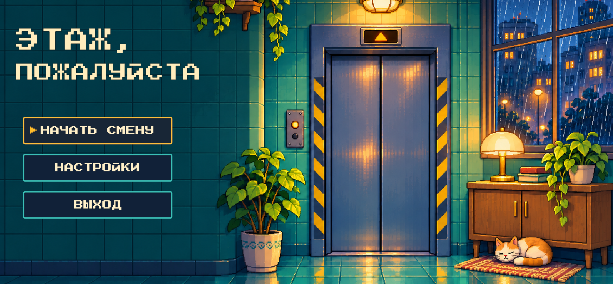
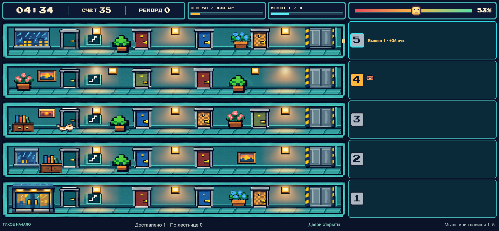
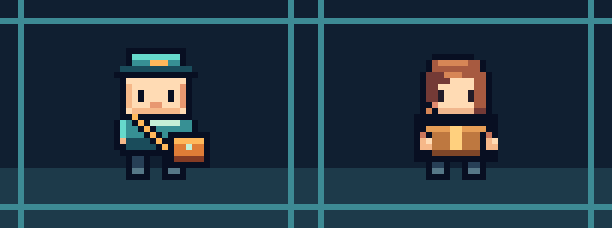

# Этаж, пожалуйста

Пиксельный симулятор лифта в пятиэтажном доме. За пять минут смены нужно развезти жильцов, удержать довольство и побить рекорд. За окнами идёт дождь, а в подъезде постепенно начинается час пик.

**Играбельный прототип** · **Unity 6.6** · **C#** · **Aseprite**

## Как проходит смена

Выбираешь этаж, лифт забирает столько пассажиров, сколько помещается по весу и по месту. Пункт назначения становится виден после посадки. У каждого ожидающего своя полоска терпения. Когда она заканчивается, жилец уходит по лестнице.

За доставку начисляются очки. Более тяжёлые пассажиры приносят больше очков, а количество свободных мест влияет на то, кого лифт сможет забрать. В течение смены поток вызовов растёт, поэтому приходится решать, закончить ли текущую поездку или сделать ещё одну остановку.

### События

| Событие | Что меняется |
| --- | --- |
| **Переезд** | Жилец с коробкой занимает три из четырёх мест. Доставка приносит 45 очков. |
| **Гости расходятся** | Трое гостей выходят друг за другом из одной квартиры и едут к выходу. |
| **Спешащий курьер** | Курьер с сумкой ждёт 12 секунд. Если успеть его доставить, он приносит 30 очков. |

## Запуск в Unity

1. Склонируйте репозиторий. В **Unity Hub → Add** выберите папку, в которой лежат `Assets`, `Packages` и `ProjectSettings`.
2. Откройте проект в Unity **6000.6.2f1**. Точная версия закреплена в [ProjectVersion.txt](ProjectSettings/ProjectVersion.txt).
3. В окне **Project** откройте [ElevatorGame.unity](Assets/_Project/Prototype/Scenes/ElevatorGame.unity), нажмите **Play** и выберите **Начать смену**.

| Действие | Управление |
| --- | --- |
| Начать смену | Кнопка в меню или **Enter** |
| Отправить лифт | Кнопка этажа или клавиша **1–5** |

## Материалы проекта

| Раздел | Содержимое |
| --- | --- |
| [Игровой код](Assets/_Project/Prototype) | Модель смены, выбор пассажиров, сцена и интерфейс. |
| [Пиксель-арт](art/2d) | Исходники Aseprite, экспорт спрайтов и предпросмотры. |
| [Питч](design/gdd/game-concept.md) и [дизайн-документ](design/gdd/game-design.md) | Игровой цикл, правила смены и события. |
| [Тесты](Assets/_Project/Tests) | EditMode для правил игры и PlayMode для сцены и управления. Запуск через **Window → General → Test Runner**. |
